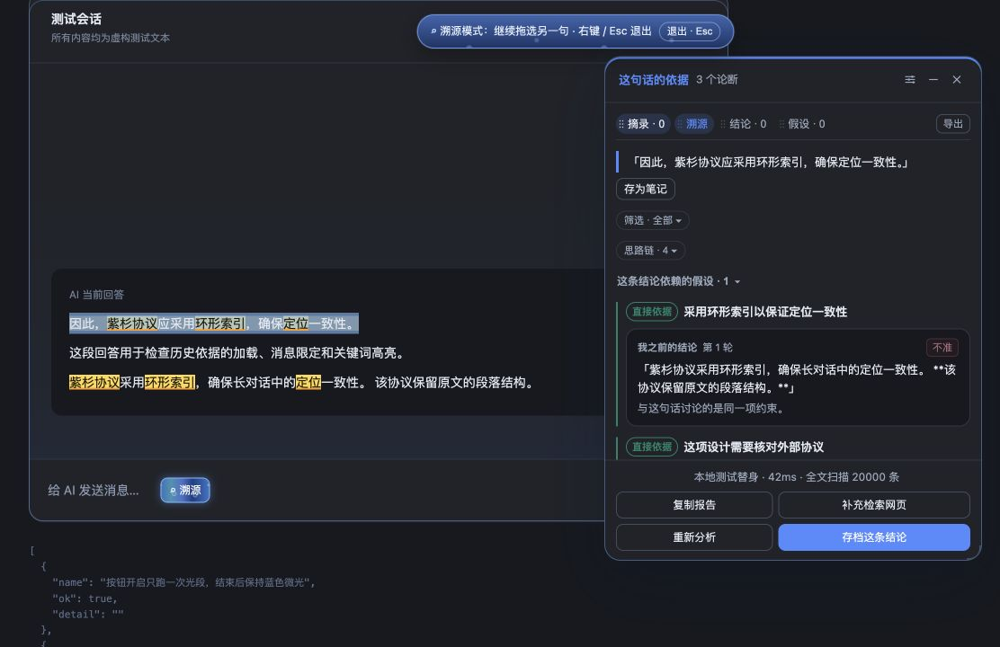

# DSH 对话溯源助手

**dsh-chat-source-tracer · V0.3.1（0.3.1）**

**选中一句回答 → 反查此前的候选依据 → 分类呈现 → 跳回原文核对。**

DSH 对话溯源助手把 AI 回答中的一条说法，与它出现之前的用户消息、AI 回答和工具材料对应起来。你可以查看哪些历史原文可能支持这条说法、哪些关联属于推论，再回到来源检查原话和上下文。

## 从一句回答回查依据

1. **选中待核对的说法。** 打开「溯源」，在一条 AI 回答里选中一句话或一段文字，作为本次分析的目标。
2. **反查此前的记录。** 插件读取会话日志，从目标消息之前的用户、AI 和工具记录中检索候选片段；当前选文所在消息与后续消息不会成为本对话分析的历史依据。
3. **分类呈现支持关系。** 面板区分直接依据、推论、合并来源与未找到依据，列出可核对的逐字引用和关联理由。引用的消息身份与文本会由代码核对，支持关系仍需使用者判断。
4. **跳回原文核对。** 点击依据，回到来源消息中的引用位置，检查上下文。较早的消息会尝试自动加载；无法可靠定位时会提示。

**核心结果是「待核对的说法—支持类型—历史原文—关联理由」的对应关系。** 对话搜索、摘录笔记和引用追问围绕这条核对流程，提供查找、保存和继续讨论的能力；重要的结论与待确认的假设也可以分别存档并导出。

*Core workflow: select a statement in an AI answer → retrieve candidate support from earlier chat and tool records → classify support → open the original passage for review.*

> 溯源结果是基于已有文本的候选关联分析，不代表模型真实的生成过程，也不保证事实正确。「未找到依据」表示当前检索未找到足够支持，不能据此断定整个历史中不存在依据。0.x 版本仍在持续完善，归因准确率、真实超长会话和不同 DSH 版本的兼容性仍需持续验证。

## 版本更新

### V0.3.1 · 2026-10-21

- **名称更直观**：项目名称统一为 `dsh-chat-source-tracer`，中文名为「DSH 对话溯源助手」。
- **安装与反馈入口统一**：仓库地址、插件包名、运行入口、文档与市场条目使用新名称，重新提供安装包与源码交付包。
- **保留已有档案**：继续使用原有本地存储键，摘录、结论、假设和界面偏好保持兼容。

### V0.3 · 2026-10-20

- **围绕原文直接追问**：跳到来源后点击「追问」，原文会作为引用加入当前输入框，接着输入问题即可。已有草稿和附件会保留，准备好后再自行发送；操作条保留「返回」。
- **分析可以随时取消**：选错内容时，点击「取消分析」即可停止当前请求；保留选文，方便重新选择或再次分析。
- **长内容更容易阅读**：选文默认显示四行，摘录、结论和假设默认显示三行，右侧按钮可展开全文；日期和全文按钮在同一行，四个主标签固定在小窗顶部。
- **界面更紧凑**：「筛选、思路链、依赖假设」整合为一行；修复「查看档案」与返回对话的跳转，模式提示随对话区域保持居中。
- **分析有轻柔动效**：修正圆形加载指示，增加底部气泡与缓慢波浪，分析结束后淡出；可在设置中关闭。
- **回收站有明确保留范围**：所有会话合计最多 50 条，移入超过 30 天自动清理；超出条数时清理最早移入的记录。

> 更新提示：升级后会按上述规则整理已有回收站，超出数量或保留期限的内容会被永久清理。需要保留的记录请先恢复或导出 JSON 档案；正常保存的摘录、结论和假设不受影响。

### V0.2 · 2026-10-20

- **搜索更顺手**：小窗内新增搜索条，摘录、结论、假设按当前标签筛选；溯源标签支持在对话中查词、定位和高亮，本地搜索不调用模型。
- **关联其他会话**：自动查找本地候选，绿色圆点提示可切换到「全对话」；需要时再点击分析关系。
- **从原文接着聊**：悬停选中的来源文字，可将原文引用加入输入框；保留已有草稿与附件，由使用者自行发送。看完也能一键返回刚才的阅读位置和选区。
- **整理内容更方便**：删除后直接进入回收站，支持恢复摘录、结论和假设；长引文可以展开，日期与消息编号显示更简洁。
- **界面与说明整理**：删除和关闭操作增加浅红色悬停反馈，压缩小窗底部布局，整理公开文档。

### V0.1 · 2026-10-20

首次测试版提供选文溯源、历史原文定位、摘录与结论档案、网页补充检索、导出及界面自定义。

完整记录见 [更新日志](CHANGELOG.md)。



## 主要功能

**选中文字，核对依据。** 在同一条消息里选中词句或段落，插件会检索此前的用户消息、AI 回答和工具材料，再交给归因模型分析。面板会区分直接依据、推论、合并来源和未找到依据的内容，一次最多选择 6,000 字。

**点击引用，回到原文。** 定位时会核对消息编号和引用文本。较早的消息尚未显示时，会尝试加载相应历史，再定位到消息内部。找不到或无法可靠定位时会给出提示。

**保存摘录、结论和假设。** 摘录保留原句与来源位置；结论和假设有各自的页面，方便持续整理。觉得引用不准确时，可以标记「不准」并重新分析。档案支持 Markdown 和 JSON 导出，便于备份。

**按需补充网页材料。** 配置可用的 DSH web provider 后，可以从面板发起补充检索。新找到的网页材料会单独展示，便于与原对话中的依据区分。

**围绕原文，直接追问。** 跳到原文后，把鼠标放在选中的文字上，点击小操作条中的「追问」，即可带着原文引用进入当前输入框，直接在「我的追问：」后输入问题。已有草稿和附件会保留，消息由使用者编辑后自行发送。操作条中的「返回」可以恢复之前的阅读位置和选区，也支持从关联会话返回。

**清楚呈现证据。** 卡片分别展示来源、原文和关联理由。较长的引文默认显示三行，可单独展开；点击卡片仍能跳回原文。日期默认简写为「今天 11:27」，完整时间与消息编号保留在悬停提示中。

**删除后可以恢复。** 摘录、结论和假设删除后直接进入回收站，可恢复到原来的分类。所有会话合计最多保留 50 条；移入超过 30 天的记录自动清理，超出容量时优先清理最早移入的记录。来源位置、依据和确认状态一并保留，JSON 档案导出也包含仍在回收站内的内容。

## 小窗搜索

鼠标移到右侧小窗底部或通过键盘聚焦时，搜索条会向上渐显。输入时保持展开，离开且没有输入时收起。

- 在「摘录、结论、假设」中，优先筛选当前标签保存的内容，并标记匹配文字、显示结果数量。需要扩大范围时，可点「去对话里找」。
- 在「溯源」中，输入停顿后会检索当前会话的用户、AI 和工具文本，定位并高亮匹配词句。较早的消息会尝试自动加载，长回答会滚动到匹配文字所在行。
- 点击匹配结果可以切换位置；点「溯源这段」才会启动归因分析。搜索本身不调用模型。

搜索采用文本匹配，英文不区分大小写，连续空白按空格处理。完全改写、没有共享词的相似表达可能无法匹配；被 Markdown 标记隔开的词组可尝试缩短后查找。

## 跨会话关联

选中一句话后，插件会在当前 DSH 可访问的其他会话中进行本地检索。标题旁的范围按钮默认显示「本对话」；找到候选时会出现绿色圆点，可切到「全对话」查看相关摘录、来源会话和时间，并打开原文。

本地查找和范围切换不调用模型。需要进一步判断关系时，点击「分析关系」，模型会根据少量候选片段说明相似观点、补充支持、观点变化或可能矛盾。实际用量取决于片段长度、输出和重试情况。

绿色圆点表示发现候选关联，不能证明 AI 当时使用过另一会话的内容。晚于选句出现的材料不能作为它当时的依据。未找到候选时按钮不可切换；读取失败会单独提示并提供重试。

## 长对话检索

插件读取当前会话的完整逻辑日志，在选中内容之前的消息中分片检索；单条长回答的中间和尾部也会参与匹配。扫描分批进行并支持取消，交给归因模型的是筛选后的候选片段，文本预算约为 42,000 字符。

文本相关性检索可能漏掉完全改写的表达。「未找到依据」表示当前检索未找到足够支持，不代表整个对话中绝对不存在依据。读取与定位能力也受 DSH 历史加载机制和本机内存限制。

检索层的合成压力测试覆盖 10 万条消息、约 5,209 万字符。真实 DSH 页面在同等规模下的端到端行为仍需验证，具体范围见 [验证说明](docs/TESTING.md)。

## 界面与操作

输入框旁的「溯源」按钮控制模式开关，也支持 `⌘⌥T` / `Ctrl+Alt+T`。开关时蓝色光段沿边缘绕行一周；开启后保留柔和的蓝色边框和底部渐变波浪，作为模式提示。背景效果位于文字、消息和输入框下方，不拦截点击。

右侧小窗支持六种主题、字号和尺寸调整，关闭与收起带淡出动效，滚动到边界时有轻微回弹。可点击的按钮和引用在悬停时会提亮，「不准」操作带淡红色边框。系统开启「减少动态效果」后，相应动画会停用。

选中的原文默认显示四行，摘录、结论和假设默认显示三行，超过后可通过右侧按钮展开。日期与全文按钮在同一行，跳转和删除紧随其后。分析过程中可以点击「取消分析」，停止当前分析并保留选文。

分析时，小窗底部会浮起淡蓝色气泡与缓慢移动的波浪，结束后逐渐淡出。可在设置中取消「分析气泡与波浪」，系统开启「减少动态效果」时也会停用。

「溯源、结论、假设、摘录」四个标签固定在小窗顶部，可以拖动排序，顺序会自动保存。键盘聚焦标签后，按 Option/Alt + 左右方向键也能移动；设置中的「标签顺序 → 恢复默认」可以重置。

## 安装与使用

本插件适用于 **DeepSeek Harness**，已验证环境为 **DSH 0.2.1-rc.2**。使用归因分析前，需要在 DSH 中配置可用的模型提供方。

从 [V0.3.1 Release](https://github.com/Milaro001/dsh-chat-source-tracer/releases/tag/v0.3.1) 下载 `.tgz` 安装包，或通过命令安装：

```sh
dsh plugin add https://github.com/Milaro001/dsh-chat-source-tracer/releases/download/v0.3.1/dsh-chat-source-tracer-0.3.1.tgz
```

也可使用仓库来源：

```sh
dsh plugin add https://github.com/Milaro001/dsh-chat-source-tracer
```

由旧包名安装的版本，请先停用旧插件，再安装新包并重载，避免出现重复入口。档案与界面偏好沿用原有本地存储。

桌面版未配置 `dsh` 命令时，可在插件管理界面的安装入口填写相同来源。安装或更新后重载插件，确认输入框旁出现「溯源」。多个来源的版本应只启用一个，避免重复入口。

1. 打开会话，点击「溯源」。
2. 在一条消息内选中文字，等待分析。
3. 查看来源与引用，点击依据回到原文。
4. 保存需要的摘录、结论和假设。
5. 从档案导出 Markdown 或 JSON 进行备份。

Release 中的 `.tgz` 用于安装，ZIP 用于下载源码。当前为 0.x 版本，社区市场收录以目录维护者审核与合并结果为准。

## 数据与模型用量

本对话溯源读取当前会话；跨会话检索仅覆盖当前 DSH 可访问的会话。本地文本检索不调用模型。归因分析与按需关系分析会将选中文字及筛选后的相关片段发送给 **DSH 当前配置的模型提供方**，可能产生模型费用。补充网页检索使用配置的 web provider。

摘录、档案和界面偏好保存在本机浏览器的 `localStorage`，目前不跨设备同步。清理应用数据前请导出备份。提示词会遮盖部分常见密钥格式，敏感内容仍需在使用前自行检查。

原文追问使用 DSH 的草稿插入接口；接口不可用或输入框暂时无法编辑时会提示。返回记录最多保留 10 次，仅存于内存，退出溯源模式或主动切换到无关会话后清空。

## 反馈与支持

报错、功能建议和使用反馈请提交到 [Issues](https://github.com/Milaro001/dsh-chat-source-tracer/issues/new/choose)。问题描述建议包含插件版本、DSH 版本、操作步骤和实际结果。发布截图或示例前，请移除私人对话、密钥和个人信息。

更多反馈方式见 [支持说明](SUPPORT.md)，测试范围见 [验证说明](docs/TESTING.md)，发布流程见 [发布说明](PUBLISHING.md)。

## 许可证

[MIT License](LICENSE)
